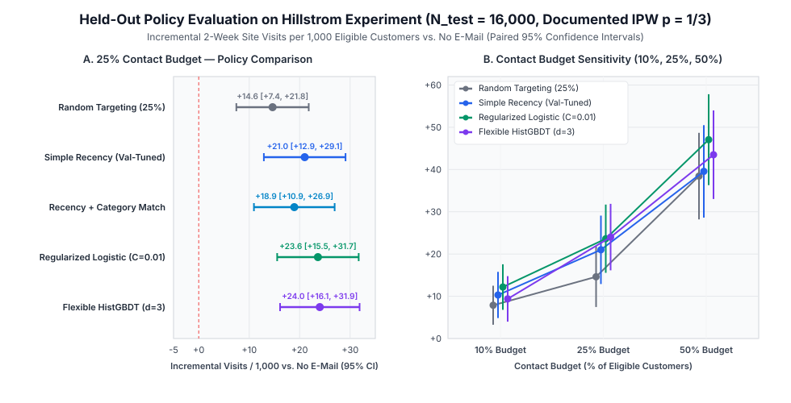

# Email Uplift Targeting Study (`email-uplift-study`)

Decision-focused analysis of the **Hillstrom MineThatData Email Merchandise Randomized Experiment** (`N = 64,000` customers randomized `1/3` each to `Mens E-Mail`, `Womens E-Mail`, or `No E-Mail`).

---

## Executive Summary & Decision Recommendation

- **Decision Question**: Under a **25% contact budget**, which customers should receive an email, and which version (`Mens E-Mail` or `Womens E-Mail`) should they receive?
- **Main Takeaway (`N_test = 16,000`)**: At a **25% contact budget**, the **Simple Recency Rule** added an estimated **`+21.00` visits per 1,000 eligible customers** versus sending no email (paired 95% CI `[+12.90, +29.10]`), and the held-out evidence was **inconclusive** about whether either model improved on that rule (`regularized_logistic` vs. `simple_recency_rule`: **`+2.62`** visits/1,000, paired 95% CI `[-5.85, +11.10]`, disagreeing on **`29.4%`** of customers; `flexible_hist_gbdt` vs. `simple_recency_rule`: **`+3.00`** visits/1,000, paired 95% CI `[-5.94, +11.94]`, disagreeing on **`33.4%`** of customers).
- **Primary & Secondary Outcomes**: Two-week site visits (`visit`, primary), purchases (`conversion`, secondary), and spend (`spend` in `$`, secondary) per 1,000 eligible customers on the held-out test split (`N_test = 16,000`), evaluated off-policy using the experiment's documented randomization probabilities ($p(a) = 1/3$) and paired 95% confidence intervals.

### Headline Held-Out Results (`25%` Contact Budget, `N_test = 16,000`)

| Targeting Policy (25% Contact Budget) | Contacted (`% Mens` / `% Womens`) | Total Visits / 1k (95% CI) | Incremental Visits / 1k vs. `No E-Mail` (Paired 95% CI) | Incremental Visits / 1k vs. `Simple Recency` (Paired 95% CI) | Disagreement vs. `Simple Recency` | Incremental Conversions / 1k vs. `No E-Mail` (95% CI) | Incremental Spend / 1k ($) vs. `No E-Mail` (95% CI) |
| --- | --- | --- | --- | --- | --- | --- | --- |
| `no_email` (0% Contact Baseline) | `0.0%` (`0.0% / 0.0%`) | `106.12` (`[97.54, 114.71]`) | `+0.00` (`[+0.00, +0.00]`) | `-21.00` (`[-29.10, -12.90]`) | `25.0%` | `+0.00` (`[+0.00, +0.00]`) | `$+0.00` (`[$+0.00, $+0.00]`) |
| `random_targeting` | `25.0%` (`12.4% / 12.6%`) | `120.75` (`[111.61, 129.89]`) | **`+14.62`** (`[+7.45, +21.80]`) | `-6.38` (`[-15.92, +3.17]`) | `40.5%` | `+0.19` (`[-1.50, +1.87]`) | `$+83.56` (`[$-215.78, $+382.90]`) |
| `recency_category_affinity` | `25.0%` (`14.4% / 10.6%`) | `125.06` (`[115.77, 134.35]`) | **`+18.94`** (`[+10.93, +26.94]`) | `-2.06` (`[-7.62, +3.50]`) | `10.6%` | `+1.69` (`[-0.29, +3.67]`) | `$+377.95` (`[$-19.58, $+775.49]`) |
| **`simple_recency_rule`** (`mens_default`) | `25.0%` (`25.0% / 0.0%`) | `127.12` (`[117.76, 136.49]`) | **`+21.00` (`[+12.90, +29.10]`)** | `+0.00` (`[+0.00, +0.00]`) | `0.0%` | `+1.88` (`[-0.14, +3.89]`) | **`$+399.12` (`[$-14.82, $+813.05]`)** |
| **`regularized_logistic`** (`C=0.01`) | `25.0%` (`17.6% / 7.4%`) | `129.75` (`[120.29, 139.21]`) | **`+23.62` (`[+15.55, +31.70]`)** | **`+2.62` (`[-5.85, +11.10]`)** | `29.4%` | `+1.69` (`[-0.36, +3.73]`) | `$+157.33` (`[$-169.84, $+484.49]`) |
| **`flexible_hist_gbdt`** (`depth=3, leaf=200`) | `25.0%` (`19.7% / 5.3%`) | `130.12` (`[120.66, 139.59]`) | **`+24.00` (`[+16.13, +31.87]`)** | **`+3.00` (`[-5.94, +11.94]`)** | `33.4%` | **`+2.25` (`[+0.11, +4.39]`)** | `$+366.96` (`[$-8.85, $+742.77]`) |



### Recommendation When Model Advantage Is Uncertain

1. **Statistical Evidence on Held-Out Customers (`N_test = 16,000`)**:
   - Every 25%-budget policy beats sending **No E-Mail** (`+14.62` visits/1,000 for `random_targeting`, `+21.00` for `simple_recency_rule`, `+23.62` for `regularized_logistic`, and `+24.00` for `flexible_hist_gbdt`).
   - However, the direct paired 95% confidence intervals at the 25% budget **do not establish a statistically significant improvement** for either model over `simple_recency_rule` (`+2.62 [-5.85, +11.10]` visits/1,000 for `regularized_logistic` and `+3.00 [-5.94, +11.94]` for `flexible_hist_gbdt`), nor do the direct paired 95% confidence intervals versus `random_targeting` exclude zero (`+6.38 [-3.17, +15.92]` for `simple_recency_rule`, `+9.00 [-0.62, +18.62]` for `regularized_logistic`, and `+9.38 [-0.09, +18.84]` for `flexible_hist_gbdt`).
2. **Practical Recommendation**:
   - **Ship the Simple Recency Rule (`simple_recency_rule`)**: contact the 25% most recent purchasers (ordered by `recency` ascending and prior `history` spend descending) and send `Mens E-Mail`. It adds an estimated **`+21.00` visits per 1,000 eligible customers** (`[+12.90, +29.10]`) and **`+$399.12` spend per 1,000 eligible customers** (`[-$14.82, +$813.05]`) versus sending no email, with zero model-scoring infrastructure or feature-drift risk.
   - **How the Regularized Model Allocates Contacts (`17.6% Mens E-Mail` / `7.4% Womens E-Mail`)**: `regularized_logistic` (`C=0.01`) sends `Mens E-Mail` to `17.6%` of eligible customers (prioritizing recent buyers who purchased both Men's and Women's merchandise or Men's-only merchandise) and `Womens E-Mail` to `7.4%` of eligible customers (recent buyers of exclusively Women's merchandise), disagreeing with `simple_recency_rule` on **`29.4%`** of customers.
   - **If Testing the Model Further**: Rather than replacing the recency rule on inconclusive offline evidence, run an online A/B test restricted to the **`29.4%` disagreement cohort** where `regularized_logistic` and `simple_recency_rule` prescribe different actions.

---

## Fresh-Clone Quickstart & One-Command Reproduction

### 1. Clone the Repository and Download the Verified Dataset

- **Original Source**: Kevin Hillstrom, *MineThatData E-Mail Analytics And Data Mining Challenge* (`64,000` rows, `12` columns).
- **Verified Mirror**: https://github.com/W-Tran/uplift-modelling/blob/master/data/hillstrom/Kevin_Hillstrom_MineThatData_E-MailAnalytics_DataMiningChallenge_2008.03.20.csv
- **Destination Path**: `data/hillstrom-email-experiment.csv` (kept out of Git via [`.gitignore`](.gitignore)).
- **Expected SHA-256 Checksum**:
  ```text
  27bab8c5d3669f26ec08ebb50a0a78317542f29501156f2e2af6781fab4cd7e2
  ```

```bash
git clone https://github.com/colinsohn/email-uplift-study.git
cd email-uplift-study

# Download the CSV from the verified mirror into data/hillstrom-email-experiment.csv
curl -fsSL "https://github.com/W-Tran/uplift-modelling/raw/master/data/hillstrom/Kevin_Hillstrom_MineThatData_E-MailAnalytics_DataMiningChallenge_2008.03.20.csv" \
  -o data/hillstrom-email-experiment.csv

# Verify the SHA-256 checksum
shasum -a 256 data/hillstrom-email-experiment.csv
# Expected output:
# 27bab8c5d3669f26ec08ebb50a0a78317542f29501156f2e2af6781fab4cd7e2  data/hillstrom-email-experiment.csv
```

### 2. Run Tests and Full Analysis in One Command

```bash
uv venv .venv && uv pip install --python .venv/bin/python -e ".[dev]" && .venv/bin/python -m email_uplift_study.cli && .venv/bin/pytest -v
```

Generated artifacts (all rendered directly from [`results/study_results.json`](results/study_results.json) using relative paths):
- DuckDB SQL audit queries: [`sql/experiment_audit.sql`](sql/experiment_audit.sql)
- Machine-readable study output: [`results/study_results.json`](results/study_results.json)
- Formatted Markdown report: [`results/study_report.md`](results/study_report.md)
- Policy-value & sensitivity SVG chart: [`results/policy_value_comparison.svg`](results/policy_value_comparison.svg)

---

## 1. DuckDB SQL Experiment Audit (`sql/experiment_audit.sql`)

Executed via [`run_duckdb_audit`](src/email_uplift_study/pipeline.py#L77-L95) on `data/hillstrom-email-experiment.csv` (`64,000` rows, `0` missing values across all 12 columns, `0` out-of-range rows):

### 1.1 Arm Sizes, Sample Ratio Mismatch (SRM), and Unadjusted ATEs vs. `No E-Mail`

- **Randomization check**: `Mens E-Mail = 21,307` (`33.292%`), `No E-Mail = 21,306` (`33.291%`), `Womens E-Mail = 21,387` (`33.417%`). Against the documented `(1/3, 1/3, 1/3)` allocation, $\chi^2_{\text{SRM}} = 0.1976$ ($p = 0.906$), confirming clean randomization.

| Arm / Comparison | Customers (`n`) | Visits / 1k | Visit Lift vs. Control (95% CI) | Conversions / 1k | Conversion Lift vs. Control (95% CI) | Spend / 1k ($) | Spend Lift vs. Control ($, 95% CI) |
| --- | --- | --- | --- | --- | --- | --- | --- |
| `No E-Mail` | `21,306` | `106.17` | `+0.00` (`[+0.00, +0.00]`) | `5.73` | `+0.00` (`[+0.00, +0.00]`) | `$652.79` | `$+0.00` (`[$+0.00, $+0.00]`) |
| `Mens E-Mail` | `21,307` | `182.76` | **`+76.59`** (`[+69.95, +83.23]`) | `12.53` | **`+6.81`** (`[+5.00, +8.61]`) | `$1422.62` | **`$+769.83`** (`[$+485.15, $+1054.51]`) |
| `Womens E-Mail` | `21,387` | `151.40` | **`+45.23`** (`[+38.89, +51.57]`) | `8.84` | **`+3.11`** (`[+1.50, +4.72]`) | `$1077.20` | **`$+424.41`** (`[$+168.96, $+679.86]`) |
| `Any E-Mail (Pooled)` | `42,694` | `167.05` | **`+60.88`** (`[+55.44, +66.33]`) | `10.68` | **`+4.95`** (`[+3.55, +6.36]`) | `$1249.59` | **`$+596.80`** (`[$+376.19, $+817.40]`) |

### 1.2 Pre-Campaign Covariate Balance Across Arms

All 8 pre-campaign features (`recency`, `history_segment`, `history`, `mens`, `womens`, `zip_code`, `newbie`, `channel`) satisfy $|\text{SMD}| < 0.02$ against `No E-Mail` (well below the $0.10$ threshold). Campaign assignment (`segment`) and post-campaign outcomes (`visit`, `conversion`, `spend`) are blocked from entering any feature matrix by [`validate_feature_columns`](src/email_uplift_study/pipeline.py#L41-L48).

| Pre-Campaign Feature | `No E-Mail` Mean | `Mens E-Mail` Mean | `Womens E-Mail` Mean | SMD (`Mens vs Control`) | SMD (`Womens vs Control`) |
| --- | --- | --- | --- | --- | --- |
| `channel = Multichannel` | `0.1223` | `0.1209` | `0.1206` | `-0.0041` | `-0.0051` |
| `channel = Phone` | `0.4378` | `0.4337` | `0.4420` | `-0.0083` | `+0.0086` |
| `channel = Web` | `0.4399` | `0.4454` | `0.4374` | `+0.0111` | `-0.0051` |
| `history ($ prior spend)` | `240.8827` | `242.8359` | `242.5366` | `+0.0076` | `+0.0065` |
| `mens (prior purchase 0/1)` | `0.5532` | `0.5509` | `0.5489` | `-0.0046` | `-0.0087` |
| `newbie (new customer 0/1)` | `0.5020` | `0.5015` | `0.5032` | `-0.0010` | `+0.0024` |
| `recency (months)` | `5.7497` | `5.7736` | `5.7678` | `+0.0068` | `+0.0052` |
| `womens (prior purchase 0/1)` | `0.5476` | `0.5514` | `0.5501` | `+0.0077` | `+0.0050` |
| `zip_code = Rural` | `0.1473` | `0.1522` | `0.1487` | `+0.0136` | `+0.0039` |
| `zip_code = Surburban` | `0.4518` | `0.4459` | `0.4512` | `-0.0117` | `-0.0011` |
| `zip_code = Urban` | `0.4009` | `0.4019` | `0.4001` | `+0.0020` | `-0.0018` |

---

## 2. Policy Tuning & Freezing on `train` (`32,000`) and `val` (`16,000`)

[`fit_and_freeze_policies`](src/email_uplift_study/pipeline.py#L368-L486) fits all models on `train_df` (`32,000` rows) and selects hyperparameters on `val_df` (`16,000` rows) using 25%-budget IPW incremental visits per 1,000 customers before `test_df` (`16,000` rows) is ever evaluated:
- **`SimpleRecencyPolicy`**: Ranks customers by `recency` ascending (tie-broken by `history` spend descending). On `val_df`, `mens_default` (`+22.31` incremental visits/1,000) edged `category_affinity` (`+20.25`) and was frozen as `simple_recency_rule` (both variants are reported on `test_df`).
- **`RegularizedActionResponsePolicy` (`LogisticRegression` T-Learner)**: Swept $C \in \{0.005, 0.01, 0.05, 0.1, 0.5, 1.0, 5.0\}$ on `val_df`; strong L2 regularization **`C = 0.01`** achieved the highest validation lift (`+24.19` visits/1,000, 95% CI `[+16.05, +32.32]`) and was frozen.
- **`FlexibleActionResponsePolicy` (`HistGradientBoostingClassifier` T-Learner)**: Swept `max_depth` $\in \{2, 3, 6\}$ and `min_samples_leaf` $\in \{50, 200\}$ on `val_df`; shallow constrained trees (**`max_depth = 3, min_samples_leaf = 200`**) achieved `+22.88` visits/1,000 (`[+15.09, +30.66]`), whereas deeper trees (`max_depth = 6, min_samples_leaf = 200`) overfit noise and dropped to `+12.94` visits/1,000.

---

## 3. Contact Budget Sensitivity Analysis (`10%`, `25%`, `50%` on Held-Out Test Set)

| Budget | Policy | Total Visits / 1k | Incremental Visits / 1k vs. `No E-Mail` (Paired 95% CI) | Incremental Visits / 1k vs. `Simple Recency` (Paired 95% CI) | Disagreement vs. `Simple Recency` |
| --- | --- | --- | --- | --- | --- |
| `10%` | `random_targeting` | `114.00` | `+7.88` (`[+3.26, +12.49]`) | `-2.44` (`[-9.24, +4.37]`) | `18.5%` |
| `10%` | `simple_recency_rule` | `116.44` | `+10.31` (`[+4.85, +15.77]`) | `+0.00` (`[+0.00, +0.00]`) | `0.0%` |
| `10%` | `recency_category_affinity` | `116.25` | `+10.12` (`[+4.68, +15.57]`) | `-0.19` (`[-3.81, +3.43]`) | `3.9%` |
| `10%` | **`regularized_logistic`** | **`118.31`** | **`+12.19`** (`[+6.80, +17.57]`) | **`+1.88`** (`[-4.51, +8.26]`) | `14.2%` |
| `10%` | `flexible_hist_gbdt` | `115.50` | `+9.38` (`[+3.98, +14.77]`) | `-0.94` (`[-7.54, +5.67]`) | `15.4%` |
| `25%` | `random_targeting` | `120.75` | `+14.62` (`[+7.45, +21.80]`) | `-6.38` (`[-15.92, +3.17]`) | `40.5%` |
| `25%` | `simple_recency_rule` | `127.12` | `+21.00` (`[+12.90, +29.10]`) | `+0.00` (`[+0.00, +0.00]`) | `0.0%` |
| `25%` | `recency_category_affinity` | `125.06` | `+18.94` (`[+10.93, +26.94]`) | `-2.06` (`[-7.62, +3.50]`) | `10.6%` |
| `25%` | **`regularized_logistic`** | **`129.75`** | **`+23.62`** (`[+15.55, +31.70]`) | **`+2.62`** (`[-5.85, +11.10]`) | `29.4%` |
| `25%` | **`flexible_hist_gbdt`** | **`130.12`** | **`+24.00`** (`[+16.13, +31.87]`) | **`+3.00`** (`[-5.94, +11.94]`) | `33.4%` |
| `50%` | `random_targeting` | `144.56` | `+38.44` (`[+28.20, +48.68]`) | `-1.12` (`[-12.80, +10.55]`) | `62.4%` |
| `50%` | `simple_recency_rule` | `145.69` | `+39.56` (`[+28.62, +50.50]`) | `+0.00` (`[+0.00, +0.00]`) | `0.0%` |
| `50%` | `recency_category_affinity` | `148.12` | `+42.00` (`[+30.98, +53.02]`) | `+2.44` (`[-5.12, +10.00]`) | `21.5%` |
| `50%` | **`regularized_logistic`** | **`153.19`** | **`+47.06`** (`[+36.30, +57.82]`) | **`+7.50`** (`[-2.47, +17.47]`) | `44.7%` |
| `50%` | `flexible_hist_gbdt` | `149.62` | `+43.50` (`[+33.02, +53.98]`) | `+3.94` (`[-5.85, +13.72]`) | `46.5%` |

---

## 4. Verification & Test Suite (`tests/test_uplift_study.py`)

Verified by [`tests/test_uplift_study.py`](tests/test_uplift_study.py):
1. **`test_split_leakage_and_feature_firewall`**: Asserts `train` (`32,000`), `val` (`16,000`), and `test` (`16,000`) row IDs are mutually disjoint, `validate_feature_columns` rejects `segment`, `visit`, `conversion`, and `spend`, and mutating `test` outcomes/assignments has zero effect on policy predictions.
2. **`test_contact_budget_enforcement`**: Asserts every policy contacts exactly $\lfloor B \cdot N \rfloor$ customers at `0%`, `10%`, `25%`, and `50%` budgets and assigns only valid actions.
3. **`test_ipw_estimator_on_toy_experiment_with_known_effect`**: Verifies [`evaluate_policy_ipw`](src/email_uplift_study/pipeline.py#L131-L147) and [`compare_policies_paired`](src/email_uplift_study/pipeline.py#L150-L176) on a balanced 3-arm toy experiment with an exact known `+100.0` visits/1,000 treatment effect (recovered to `< 1e-9` error) and on a seeded stochastic RCT with asymmetric assignment probabilities `(0.50, 0.25, 0.25)`.
4. **`test_duckdb_audit_and_dataset_checksum`**: Verifies the SHA-256 checksum of `data/hillstrom-email-experiment.csv` and validates the DuckDB SQL audit invariants.
5. **`test_report_generator_matches_study_results_json`**: Asserts that `render_markdown_summary` regenerates [`results/study_report.md`](results/study_report.md) identically from [`results/study_results.json`](results/study_results.json) with no stale or hardcoded numbers.
